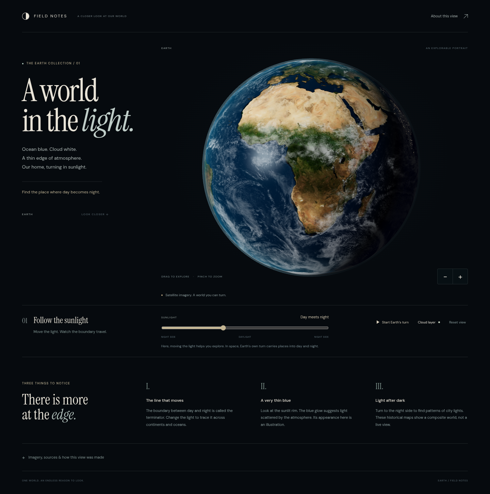
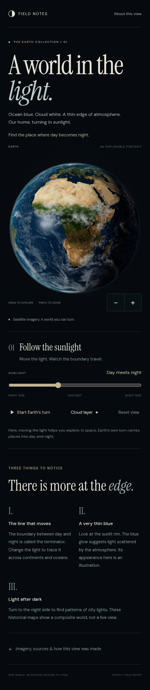

# Visual reference

Run `assets/reference/` over HTTP and inspect its actual movement and controls as well as these captures. The composition prioritizes a detailed subject, expressive typography, an immediate manipulation, and a short explanation.

Captured from the reference on 17 October 2026 using Chromium, local fonts and assets, and software WebGL. Desktop viewport: 1440 × 960; phone viewport: 390 × 844. These are full-page captures with reduced motion, so they record composition rather than animation performance.

Notice the subject's scale and surface detail, the separation between editorial type and the scene, the thin atmospheric edge, and the close relationship between the sunlight control and its result. On the phone the subject is reframed and the reading order stays intact. See [the implementation notes](../assets/reference/README.md) for attribution and rendering choices.

The space palette and spherical subject are specific to this example. Carry its visual detail, considered composition, and responsive interaction into a new subject using an appropriate visual language.
