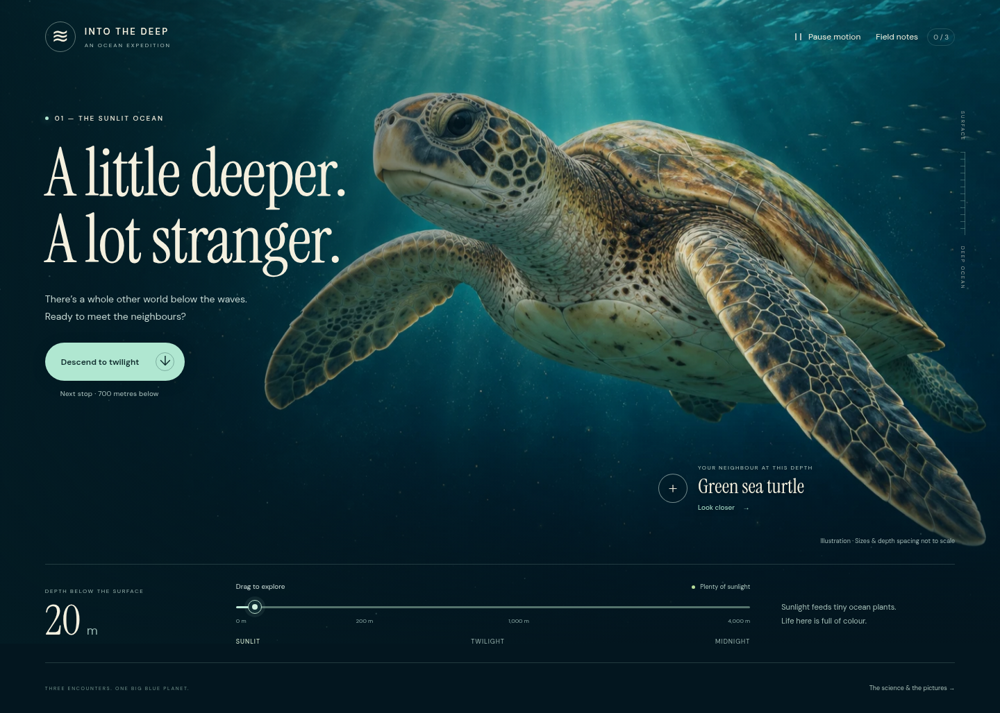
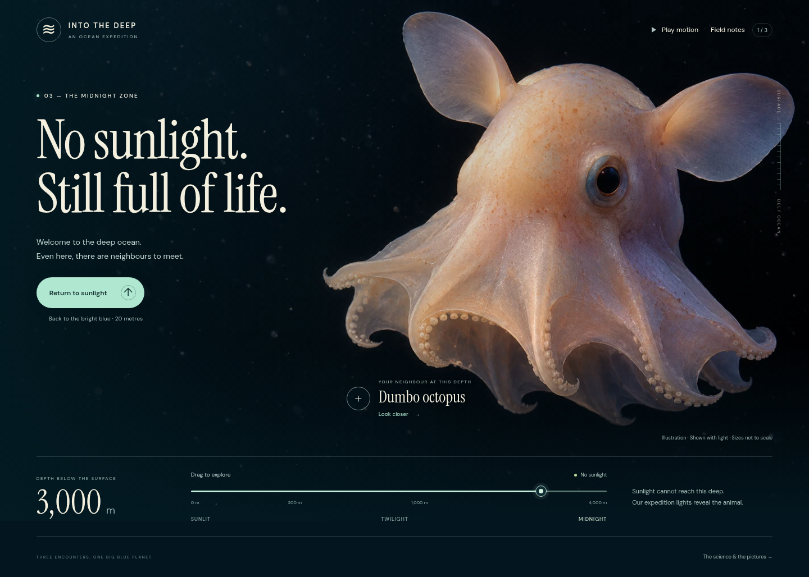
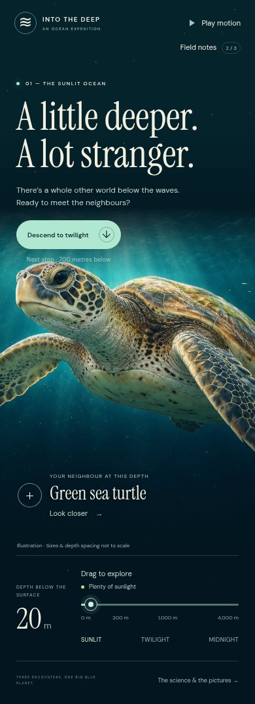

# Transfer trial: Into the Deep

Tested on 17 October 2026. A fresh agent, without the parent conversation, received the new skill directory and an ordinary request to make an impressive ocean explorer for an eight-year-old. It worked in an empty project and followed the skill: inspect the reference, decide the visual direction, create and inspect subject assets, finish one scene, then review and extend it.

The complete [worked example](into-the-deep/README.md) is included. Its [art direction](into-the-deep/ART_DIRECTION.md), [rendered review](into-the-deep/REVIEW.md), [sources](into-the-deep/SOURCES.md), and [asset credits](into-the-deep/ASSET_CREDITS.md) document the decisions. The original working project was `/workspace/IntoTheDeep`; the package contains its portable application and browser test harness, without raw research HTML or original image-generation files.

## Result observed

The opening uses detailed turtle artwork, a large editorial heading, and a compact depth instrument. Moving the depth control changes the light and carries the visitor through three illustrated encounters. Stationary inspection panels and an observation question make the animals accessible beyond the moving scene. The desktop composition gives the creature most of the canvas; the phone layout deliberately scrolls to preserve a large animal image.

## Findings and fixes

The opening review found the turtle's face competing with the title on phones. The implementation now gives the creature its own image band. Integrated review found a long twilight heading wrapping into the artwork, an ascent button with a downward arrow, and a label crossing the dumbo's pale arm. Those were fixed and the revised views were reopened. Browser interaction checks also found and removed duplicate dialog focus restoration that could steal focus from the next control.

The [browser report](evidence/ocean-test-results.json) records successful descent and reversal, all three creatures, deliberate discovery answers, keyboard controls, pause, initial and changing reduced motion, hidden-document suspension, failed-image recovery, and portrait/landscape layouts. No normal-runtime JavaScript errors or failed requests were recorded. The [single-file export check](evidence/ocean-offline-export.json) also passed with networking disabled and only the HTML document supplied; images, fonts, interactions, and credit downloads were self-contained. Direct `file://` navigation was blocked by the managed browser and was not tested. The review included an actual descent frame sequence in addition to still images. Root review independently inspected desktop and phone renders and the final midnight composition.

## What this establishes

This trial produced a small, visually detailed exhibit from the new skill without subject-specific user correction during the trial. Its useful transferable parts are the asset-first workflow, a concrete reference, subject-led interaction, and review of actual rendered states. One successful trial is evidence of that workflow, not a guarantee for every subject or model.

The ocean uses generated illustrations, layered drift, particles, and dissolves. It is not a rigged 3D animal simulation. Image anatomy was not independently certified; the interface identifies the art as illustration, with expedition lighting and compressed scales. There was no child usability session, screen-reader session, or physical-phone frame-rate measurement.
